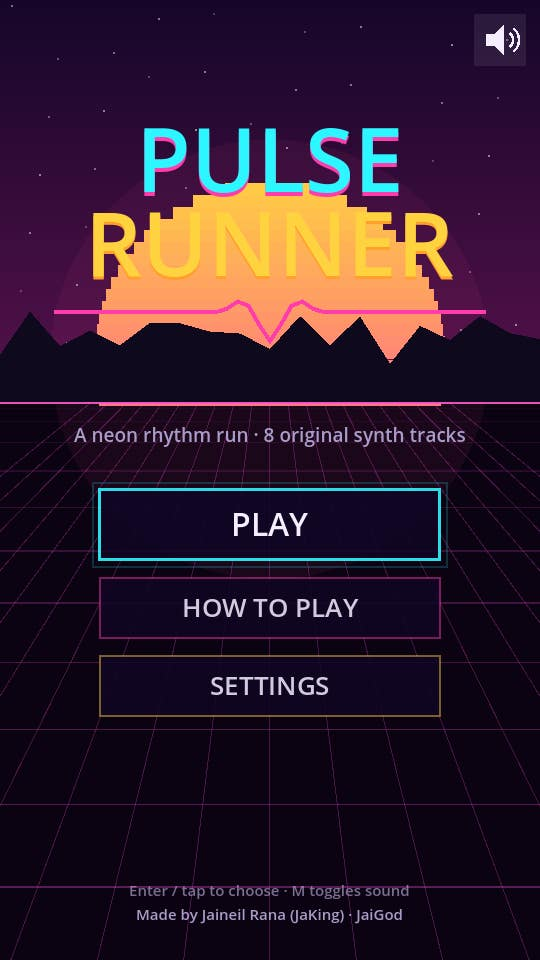
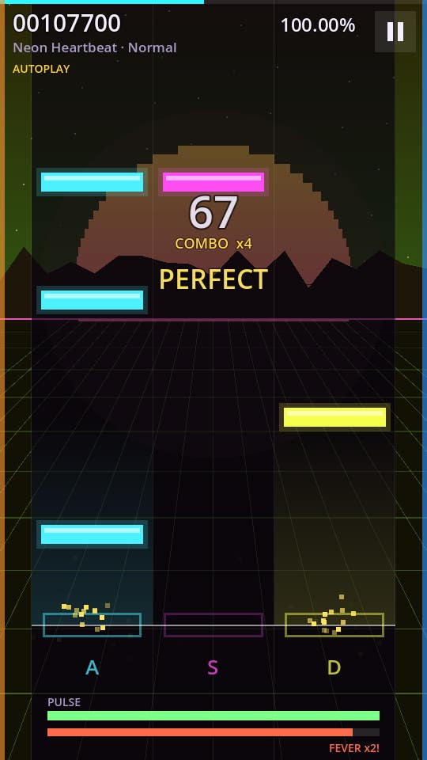
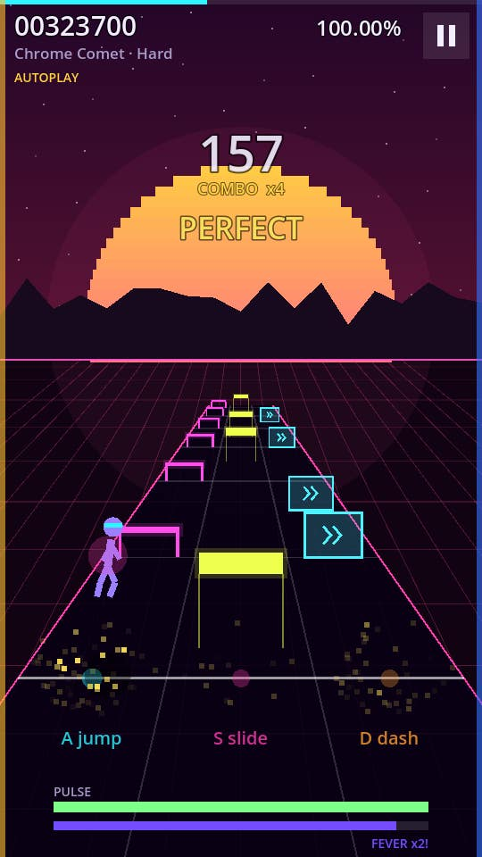
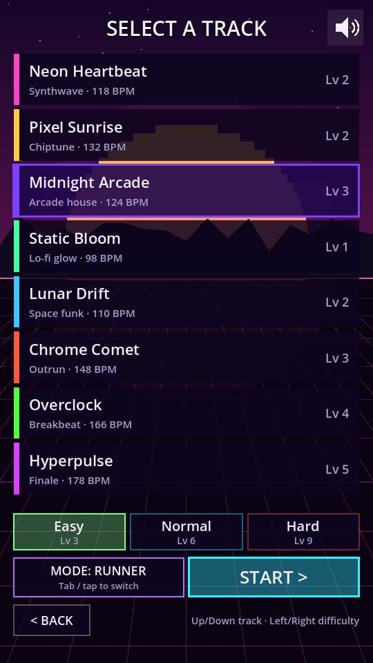
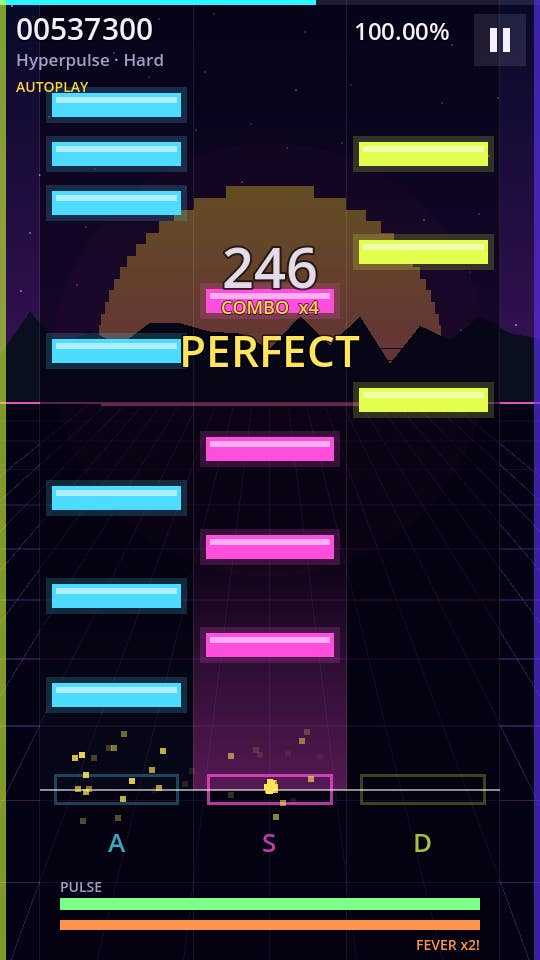
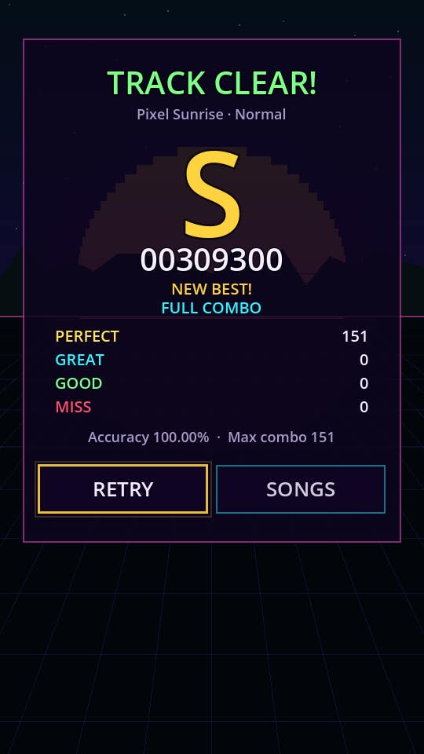
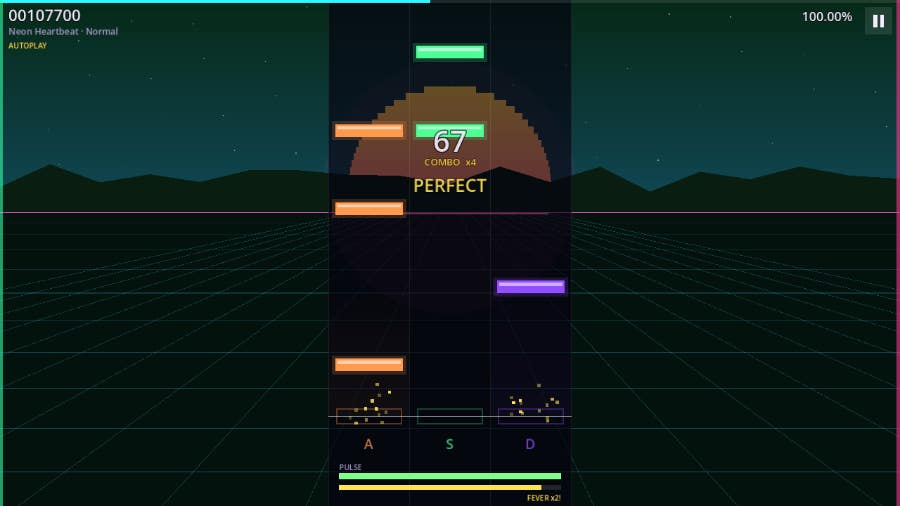
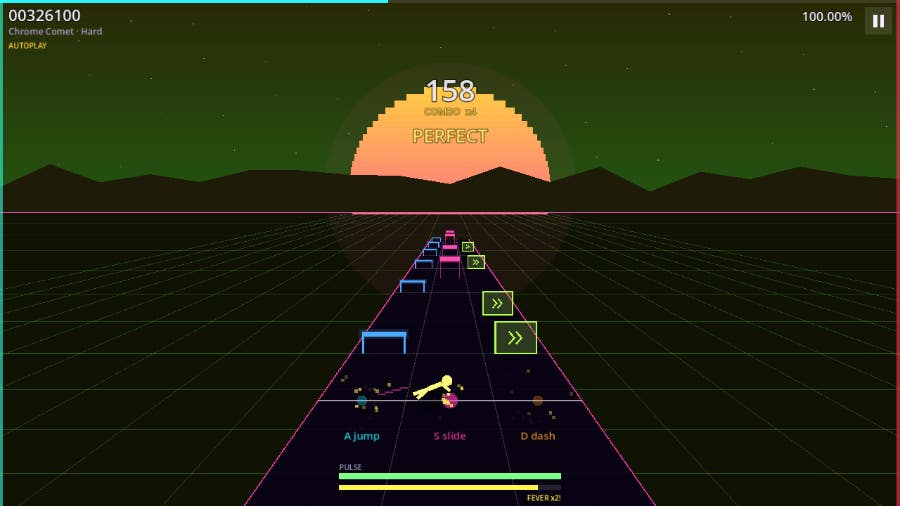

<div align="center">

# 💓 PULSE RUNNER 🏃

### An original neon rhythm game with 4 lanes, a runner mode and 8 songs synthesized entirely in code

[](https://jaigod.github.io/pulse-runner/play/)

[](https://jaigod.github.io/pulse-runner/)
[](https://godotengine.org)
[](https://github.com/JaiGod/pulse-runner/actions)
[](LICENSE)
[](https://github.com/JaiGod)

  

</div>

---

## 🎮 What is it?

**Pulse Runner** is a synthwave rhythm game made in **Godot 4**. Notes scroll down four neon lanes and you hit them on the beat with **D F J K** (or by tapping the lanes on a phone).

Flip the **Runner** switch and the same chart turns into a glowing highway. Your runner dashes between lanes, **jumps hurdles** (D/F) and **slides under gates** (J/K) on every note.

All 8 songs are **original compositions generated by code**: a small chiptune/synthwave sequencer writes the melody, bass, drums and pads from song data, then renders them to audio when the track loads. The game ships with **no audio files and no copyrighted music**.

## ✨ Features

| | |
|---|---|
| 🎵 **8 original songs** | Synthwave, chiptune, arcade house, lo-fi, space funk, outrun, breakbeat and a 178 BPM finale |
| 🎚️ **3 charts per song** | Easy, Normal and Hard (24 charts), generated from each song's own notes so they always follow the music |
| 🏃 **Two views** | Classic 4-lane highway or the perspective **Runner** mode with jump and slide animations |
| 🎯 **Judgments** | PERFECT ±45 ms · GREAT ±90 ms · GOOD ±135 ms · MISS, with early/late ms readout |
| 🔥 **Combo + Fever** | Combo multiplier up to x4; fill the fever bar for 16 beats of double points and rainbow lanes |
| 💔 **Pulse meter** | Misses drain your pulse. Hit zero and it's **SIGNAL LOST** |
| 🏆 **Grades S to D** | Per-song, per-difficulty best score, grade and FULL COMBO badge, all saved on your device |
| ⏱️ **Calibration** | Tap along to a click track to measure audio latency, or nudge the offset by ±5 ms |
| 🏎️ **Chart speed** | x1.00 to x5.00 scroll speed |
| 📱 **Phone-ready** | Portrait layout, 4 tap columns, multitouch, no horizontal scroll at 390 px |
| ✨ **Juice** | Beat-pulsing sun and logo, particles, screen shake, judgment pop-ups and eased menus |

## 🕹️ Controls

| Action | Keyboard | Touch |
|---|---|---|
| Hit lanes 1-4 | `D` `F` `J` `K` (or `←` `↓` `↑` `→`) | Tap the 4 screen columns |
| Pause | `Esc` / `P` / `Space` | ⏸ button (top right) |
| Menus | Arrow keys + `Enter`, `Esc` back | Tap |
| Song select | `↑↓` track, `←→` difficulty, `Tab` view mode | Tap a card, tap again to start |
| Sound on/off | `M` | 🔊 button |

## 📸 Screenshots

| Title | Track select | Lanes |
|---|---|---|
|  |  |  |
| **Runner mode** | **Fever x2** | **Results** |
|  |  |  |

**Desktop (widescreen expands the scene):**

 

## 🎼 The tracklist

| # | Song | Style | BPM | Key | Levels (E / N / H) |
|---|---|---|---|---|---|
| 1 | Neon Heartbeat | Synthwave | 118 | A minor | 2 / 5 / 8 |
| 2 | Pixel Sunrise | Chiptune | 132 | C major | 2 / 5 / 8 |
| 3 | Midnight Arcade | Arcade house | 124 | E minor | 3 / 6 / 9 |
| 4 | Static Bloom | Lo-fi glow | 98 | F major | 1 / 4 / 7 |
| 5 | Lunar Drift | Space funk | 110 | G dorian | 2 / 5 / 8 |
| 6 | Chrome Comet | Outrun | 148 | D minor | 3 / 7 / 10 |
| 7 | Overclock | Breakbeat | 166 | B harmonic minor | 4 / 8 / 11 |
| 8 | Hyperpulse | Finale | 178 | C# minor | 5 / 9 / 12 |

## 🛠️ Tech stack

- **Godot 4.3** with GDScript and the **Compatibility (GL) renderer**, so the web build runs everywhere
- **Web export with threads off**, so it runs on GitHub Pages without COOP/COEP headers
- **Procedural audio**: one-shot voices (kick, snare, hats, crash, square/pulse/saw/triangle/supersaw tones with ADSR, a low-pass filter and vibrato) are synthesized, cached and mixed into a 16-bit `AudioStreamWAV`. The mixing runs in ~11 ms slices per frame, so the loading bar stays smooth
- **All graphics drawn in code** with the `CanvasItem` API: no textures or sprites
- **GitHub Actions**: headless smoke test, then Web export, then screenshots captured under Xvfb, then deploy to Pages

## 📁 Project structure

```
pulse-runner/
├── project.godot          # 540x960 portrait base, stretch=expand, GL Compatibility
├── export_presets.cfg     # Web preset (threads off)
├── main.tscn              # single scene, everything is drawn by main.gd/view.gd
├── scripts/
│   ├── main.gd            # state machine, input, clock, judgments, scoring, saves
│   ├── view.gd            # renderer: sky, lanes, runner track, runner, HUD, menus
│   ├── music.gd           # 8 songs as data + composer + Easy/Normal/Hard chart generator
│   └── synth.gd           # synth voices + chunked song renderer -> AudioStreamWAV
├── tests/
│   ├── smoke.gd           # headless test: 24 charts, menus, autoplay S rank, fail, pause
│   └── shots.gd           # Xvfb screenshot capture for this README
├── web/index.html         # landing page (deployed at /, game at /play/)
├── docs/screenshots/      # README images
└── .github/workflows/pages.yml
```

Source folders: [`scripts/`](scripts) · [`tests/`](tests) · [`web/`](web) · [`.github/workflows/`](.github/workflows)

## 🚀 Run locally

1. Install [Godot 4.3](https://godotengine.org/download) (standard build).
2. Clone the repo: `git clone https://github.com/JaiGod/pulse-runner.git`
3. Open `project.godot` in Godot and press **F5**.

Headless smoke test:

```bash
godot --headless --path . --import
godot --headless --path . res://tests/SmokeTest.tscn   # prints "SMOKE OK"
```

Web build: `godot --headless --path . --export-release "Web" build/play/index.html`, then serve `build/` with any static server (for example `python3 -m http.server`).

## 📓 Development log

**Design goals.** I wanted a rhythm game where the music and the charts come from the same data. Each song is a small "score": tempo, key, scale, a 4-chord progression, lead/bass waveforms and a drum groove. A seeded melody generator writes 2-bar motifs that land on chord tones on strong beats and move by step in between. Verses, choruses and breaks reuse their motif, so every song has a hook that repeats.

**Charts from music.** The chart generator quantizes the composed notes to a grid chosen per difficulty (minimum gaps of 0.42 s / 0.2 s / 0.105 s). Lead-melody notes take priority, then snares and kicks, then arps and hats on Hard. Lanes follow the melody's contour (up moves right, down moves left) and an anti-jack rule stops fast repeats on one lane. Normal and Hard add two-lane chords on chorus downbeats.

**Challenge: synthesizing audio fast enough.** Rendering ~75 s of audio sample by sample in GDScript took about 1.2 s per song on desktop, and longer on the web. I fixed this two ways. First, every voice (for example "lead, saw, MIDI 69, 0.25 s") is rendered once and cached, so a song becomes a list of "add buffer X at time T" events. Second, the mixer runs in ~11 ms slices per frame behind a progress bar, so the browser never freezes.

**Challenge: audio sync on the web.** With threads off, Godot 4.3's web build plays `AudioStreamWAV` as a Web Audio sample, and `get_playback_position()` reports 0 there. So the game keeps its own clock (`Time.get_ticks_usec()` since `play()`), subtracts `AudioServer.get_output_latency()` and the player's calibration offset, and only seeks the audio on resume. Each song starts with a count-in of clicks rendered into the same buffer, so the first beat is audible and in time.

**Runner mode.** The perspective road uses a simple `1 / (1 + 6u)` projection. Hurdles and gates scale with depth, and the runner eases toward the lane of each hit and plays a jump arc or a slide pose.

**Fixes along the way.** The default font has no ▶ or arrow glyphs, so the in-game labels are plain ASCII. The first lane mapping (absolute pitch) put most notes in one lane, and the contour mapping spread them evenly. Autoplay judged notes with frame lag in slow headless browsers, so it now counts as perfect. The health drain was softened so a few early misses don't end a run.

**Testing.** A headless smoke test composes all 8 songs, checks all 24 charts (sorted, valid lanes, difficulty ramps), opens every menu, renders a full track, autoplays it to an **S rank with a full combo**, and confirms that a run with no input ends in SIGNAL LOST. It also checks pause/resume and judges a real key hit. CI runs it on every push before deploying.

Beta tested on the live site ✅ (2026-11-05): the landing page and `/play/` load, the game boots past Godot's loading bar, tracks synthesize and play, autoplay and manual D/F/J/K input are judged, pause works, and the console shows no errors.

## 🌌 More JaiGod games

- [Stellar Barrage](https://github.com/JaiGod/stellar-barrage): neon bullet-hell shmup
- [Voltline](https://github.com/JaiGod/voltline)
- [Turbo Tots Kart](https://github.com/JaiGod/turbo-tots-kart)
- [The Hollow Between](https://github.com/JaiGod/the-hollow-between): story RPG
- [Moonfarm](https://github.com/JaiGod/moonfarm)
- [Browse all JaiGod repos →](https://github.com/JaiGod)

## 📄 License

[MIT](LICENSE) © 2026 Jaineil Rana. The songs, art and code are all original and generated in code.

---

<div align="center">

Made by Jaineil Rana (JaKing) · part of [JaiGod](https://github.com/JaiGod)

</div>
